# Billing and MCC: data model (draft)

Status: **sketch for discussion, not implemented.** Nothing here is migrated yet.
Builds on `docs/billing-brief.md` and the existing `accounts` / `account_members`
tables (migration 052). The decisions behind it are listed at the end.

## The idea in short

There are two kinds of account:

| | **MCC** (agency) | **User** (customer) |
|---|---|---|
| Pays | No, price exempt, except for its own shops (below) | Yes, on a plan: Standard / Advanced / Pro / Enterprise, or a custom plan |
| Created by | Gamoba only: a one-time signup link sent by email | Open signup, optionally through an MCC's referral link |
| Owns shops and feeds | Only while it has an active subscription, like a User | Yes |
| Works on clients' feeds | Through access a User grants it | — |
| Earns | A recurring % of what each User it referred pays | — |

Gamoba itself stays a **User** account with `billing_exempt = true`, not an MCC.

One login may be a member of several accounts, MCC and User alike, and switches between them in the UI.

**Plans.**
- The public plans are Standard, Advanced, Pro and Enterprise.
- A platform admin can create a **custom plan** for one specific account in the admin interface. It has its own prices and limits, and only that account can see it and subscribe to it.

**SKUs.**

*Under review. Gamoba is rethinking the counting rule, and it's the easiest part to change later.*

The current draft:
- A SKU is a **variant** that is **included in a feed**, meaning it passes the feed's filters and goes out.
- It is counted **per feed**, so a variant in three feeds counts three times.
- The account's total for a day is the sum over all its feeds.
- Billing uses the **highest daily total** in the period.
- Feed-URL shops follow the same rule: each item included in a feed counts.
- Extra SKUs are always billed **monthly**, on that month's peak, at the plan's rate:
  - On a monthly plan, they go on the monthly invoice.
  - On an annual plan, the base is paid up front for the year, and the extras are billed each month at the annual rate (× 10 / 12).

**Access.** A User grants an MCC access with one of two scopes:

- **account**: every shop and feed in the User's account, including ones created later. The MCC may also create new shops and feeds there, and they count against the User's plan.
- **feed**: one feed only. The MCC may edit that feed, and outside it sees only the shop's name and sync status, read-only.

A User may grant several MCCs, and every member of an MCC sees all of the MCC's clients. MCC seats are unlimited.

**Getting connected.** There are two ways:

1. **Referral link:** the User signs up through the MCC's link. The User is tagged as that MCC's referral (kickback), and the MCC gets account access straight away.
2. **The User's access code:** every User account has an access code, which the User gives to the MCC. The MCC enters it, and the User's owners and admins get an email asking them to approve. The User approves and picks the scope (account or feed), or declines.

Only (1) gives a kickback.

**Kickback.**
- Only the MCC whose link the User signed up through earns it.
- It runs for as long as the User pays.
- It's a percentage of the whole invoice, excluding VAT.
- The rate is a platform default, which Gamoba can override per MCC. Each referral keeps a copy of the rate it signed up at.
- **When it's paid out:**
  - **Monthly plan:** the User pays on the 1st, and the MCC gets its kickback on the last day of that month.
  - **Yearly plan:** the yearly amount is split into 12. Each month the MCC gets the rate × one twelfth, paid on the last day of the month, as for monthly.
  - **Yearly, cancelled or refunded partway through:** the parts not yet paid out are dropped, or reduced by the refund.
- **Revoking access:** if the User revokes that MCC's access, the kickback **stops by default**. If the User grants the same MCC access again, the kickback resumes on its own. A Gamoba platform admin can also see past connections and switch the kickback back on, depending on the deal with the MCC.
- **Payout is manual:** the app reports what each MCC is due at the end of each month, and Gamoba pays the MCC and marks the payout as paid. A refund that comes after its commission was paid out is deducted from the MCC's next payout.

## Diagram

```mermaid
erDiagram
    accounts ||--o{ account_members : "has"
    auth_users ||--o{ account_members : "is"
    auth_users ||--o| platform_admins : "is Gamoba staff"
    accounts ||--o{ projects : "owns"
    projects ||--o{ feeds : "has"

    accounts ||--o{ access_grants : "grants (as User)"
    accounts ||--o{ access_grants : "receives (as MCC)"
    feeds |o--o{ access_grants : "scope = feed"

    mcc_signup_invites |o--o| accounts : "creates MCC"
    accounts ||--o{ referral_links : "owns (MCC)"
    referral_links ||--o{ referrals : "brought in"
    accounts ||--o| referrals : "referred User"
    referrals ||--o{ commissions : "earns"
    commission_payouts ||--o{ commissions : "settles"
    accounts ||--o{ commission_payouts : "paid to (MCC)"

    accounts |o--o{ plans : "custom plan for"
    plans ||--o{ plan_prices : "priced as"
    plans ||--o{ subscriptions : "on"
    accounts ||--o{ subscriptions : "pays"
    accounts ||--o{ stripe_customers : "is"
    subscriptions ||--o{ commissions : "invoice of"
    feeds ||--o{ feed_sku_usage : "counted daily"
    accounts ||--o{ feed_sku_usage : "billed to"

    accounts {
        uuid id PK
        text name
        text type "NEW: mcc | user"
        boolean billing_exempt "NEW: free accounts (existing ones, Gamoba)"
        text access_code UK "NEW: User only, given to an MCC to request access"
        numeric commission_rate "NEW: MCC only, null = platform default"
        int seat_limit "existing; from plan, null for MCCs"
        uuid created_by FK
    }
    account_members {
        uuid account_id PK
        uuid user_id PK
        text role "owner | admin | member"
    }
    platform_admins {
        uuid user_id PK "Gamoba staff"
        uuid granted_by FK
        timestamptz created_at
    }
    platform_settings {
        text key PK "e.g. default_commission_rate"
        jsonb value
        uuid updated_by FK
        timestamptz updated_at
    }
    projects {
        uuid id PK
        uuid account_id FK "User, or MCC with a plan"
    }
    feeds {
        uuid id PK
        uuid project_id FK
    }
    access_grants {
        uuid id PK
        uuid user_account_id FK "the client"
        uuid mcc_account_id FK "the agency"
        text scope "account | feed; chosen by the User on approval"
        uuid feed_id FK "set only when scope = feed"
        text source "referral | access_code"
        text status "pending | active | declined | revoked"
        uuid requested_by FK "MCC member who entered the code"
        uuid decided_by FK "User member who approved or declined"
        uuid revoked_by FK
        timestamptz created_at
        timestamptz accepted_at
        timestamptz revoked_at
    }
    mcc_signup_invites {
        uuid id PK
        text email
        text token_hash "one-time, never stored in plain"
        uuid created_by FK "platform admin"
        timestamptz expires_at
        timestamptz used_at
        uuid mcc_account_id FK "filled when used"
    }
    referral_links {
        uuid id PK
        uuid mcc_account_id FK
        text code UK "the ?ref= parameter"
        boolean active
        timestamptz created_at
    }
    referrals {
        uuid id PK
        uuid mcc_account_id FK
        uuid user_account_id FK,UK "one referrer per User, ever"
        uuid referral_link_id FK
        uuid access_grant_id FK "the grant made at signup"
        numeric commission_rate "copied at signup"
        text status "pending | active | stopped"
        timestamptz signed_up_at
        timestamptz first_paid_at
        timestamptz stopped_at
        text stop_reason "access_revoked | ..."
        boolean kickback_override "admin forces it on"
        uuid override_by FK "platform admin"
        timestamptz override_at
        text override_note "the deal behind it"
    }
    commissions {
        uuid id PK
        uuid referral_id FK
        uuid subscription_id FK
        uuid payout_id FK "null = not paid out yet"
        text stripe_invoice_id "the invoice it comes from"
        int installment "1 for monthly; 1-12 for yearly"
        int invoice_amount_cents "excl. VAT; the twelfth for yearly"
        numeric rate
        int commission_cents "negative when reversed by a refund"
        text currency
        date payable_on "last day of the month it belongs to"
        text status "scheduled | dropped | reversed"
        timestamptz created_at
        boolean livemode
    }
    commission_payouts {
        uuid id PK
        uuid mcc_account_id FK
        date period_month
        int total_cents
        text currency
        text reference "bank transfer or MCC invoice no."
        uuid marked_paid_by FK "platform admin"
        timestamptz paid_at
    }
    plans {
        text id PK "standard | advanced | pro | enterprise | custom-..."
        text name
        boolean is_custom "made by a platform admin"
        uuid account_id FK "custom plans only: the one account it's for"
        uuid created_by FK "platform admin, for custom plans"
        int included_skus
        int extra_per_1000_cents
        int feed_limit "null = unlimited"
        int shop_limit
        int user_limit
        int syncs_per_day
        boolean active "custom plans can be retired"
    }
    plan_prices {
        text plan_id PK
        text interval PK "month | year"
        boolean livemode PK
        int amount_cents
        text stripe_price_id
    }
    stripe_customers {
        uuid account_id PK
        boolean livemode PK
        text stripe_customer_id UK
    }
    subscriptions {
        uuid id PK
        uuid account_id FK "User, or MCC that owns shops"
        text plan_id FK
        text kind "plan | extra_skus"
        text interval "month | year; extra_skus is always month"
        text status "Stripe status"
        text stripe_subscription_id UK
        timestamptz current_period_end
        boolean cancel_at_period_end
        boolean livemode
    }
    feed_sku_usage {
        uuid feed_id PK
        date measured_on PK
        uuid account_id FK "owner of the feed's shop that day"
        int sku_count "under review"
        timestamptz measured_at
    }
    stripe_events {
        text id PK "evt_..., for webhook idempotency"
        text type
        boolean livemode
        timestamptz processed_at
    }
```

Two tables stand alone in the diagram:
- `stripe_events`: the webhook writes the event id first, so an event that arrives twice is handled once.
- `platform_settings`: holds the platform-wide settings.

## The flows

**MCC signup.** A platform admin creates an `mcc_signup_invites` row and emails the link. The link carries a random token, and only its hash is stored. Opening it once, before `expires_at`, creates an `accounts` row with `type = mcc`, makes the person its owner and sets `used_at`. The link can't be used again.

**Referred User signup** (`/signup?ref=<code>`):

1. An `accounts` row with `type = user` and a generated `access_code`.
2. An `access_grants` row with scope `account`, source `referral` and status `active`.
3. A `referrals` row with status `pending`, linked to that grant, with the MCC's rate copied in (its own rate, or the platform default).

The first paid invoice (Stripe webhook) sets the referral to `active` with `first_paid_at`. Only **new** accounts can be referred. `user_account_id` is unique, so a User can never be referred again.

**Access by code.**
1. The MCC enters the User's `access_code`. That creates an `access_grants` row with source `access_code` and status `pending`.
2. The User's owners and admins get an email asking them to approve.
3. A User owner or admin approves (choosing account or feed scope) or declines.

The User can generate a new code at any time, and the old one stops working. Entering a code gives no kickback.

**Custom plan.** A platform admin creates a `plans` row with `is_custom = true` and `account_id` set to the customer, with its prices and limits. The matching Stripe prices go in `plan_prices`. Only that account sees the plan on its Billing page. Retiring a custom plan (`active = false`) leaves existing subscriptions on it untouched.

**Kickback per paid invoice** (Stripe webhook, while the referral is `active` or overridden):
- **Monthly invoice:** one `commissions` row, `installment = 1`, on the invoice total excluding VAT. `payable_on` is the last day of the month the invoice was paid.
- **Yearly invoice:** 12 `commissions` rows, `installment` 1–12. Each is on one twelfth of the total excluding VAT; the last part absorbs any rounding cent. `payable_on` is the last day of each of the 12 months from the payment month on.
- **Cancellation, refund or revoked access during a year:** remaining parts that aren't paid out become `dropped`, or are reduced by the refund. A refund for parts already paid out adds a negative `reversed` row, which lowers the next payout.

**Revoking access.** The grant becomes `revoked` and is kept, never deleted. If it's the User's last active grant to the referring MCC, the referral becomes `stopped` with `stop_reason = access_revoked`. No new commissions are earned, and scheduled yearly parts are dropped.

**Kickback coming back.** There are two ways:
- **Automatically:** a new `active` grant from the same User to the referring MCC sets the referral back to `active`. Commission is earned again from the next paid invoice. Invoices paid while it was stopped earn nothing.
- **By override:** a platform admin can see the history (the revoked grants and the stopped referral) and set `kickback_override`. That makes the referral `active` again with no grant, with a note on the deal.

**Payout.** At the end of each month, the admin page sums each MCC's `scheduled` commissions with `payable_on` in that month and no payout, negative rows included. When Gamoba has paid, an admin creates a `commission_payouts` row with the reference and links those commissions to it.

**SKU measuring** (under review). A daily job writes one `feed_sku_usage` row per feed. `account_id` is set to the account owning the shop that day, so a shop moving between accounts doesn't change past figures. Each month, the figure is the highest daily sum over the account's feeds. The SKUs above the plan's `included_skus` are reported to Stripe as the extra-SKU quantity.

**Annual plans and monthly extras.** The plan is billed yearly, and the extra SKUs monthly. Stripe has traditionally required every item on one subscription to share a billing interval. So the draft gives an annual account two `subscriptions` rows:
- `kind = plan`, billed yearly;
- `kind = extra_skus`, billed monthly, with a metered price at the annual rate.

A monthly account can carry both on one Stripe subscription. It's recorded as one `plan` row, plus an `extra_skus` row pointing at the same Stripe subscription. Check Stripe's current support for mixed intervals before building, as it may allow a single subscription.

## Rules (in `lib/ops`, shared by the UI and Claude)

| Rule | Where it's enforced |
|---|---|
| A project may belong to a `user` account, or to an `mcc` account with an active subscription | trigger + create-shop op |
| An MCC member reaches a User's shop or feed only through an `active` grant: account scope gives everything, feed scope gives that feed plus the shop's name and sync status | `getOwnedProject` / `getOwnedFeed` |
| Creating a shop or feed in a User's account: its own members, or an MCC with an `account` grant. Checked against the **User's** plan | create-shop / create-feed ops |
| An account needs an active subscription to own shops, unless it's `billing_exempt` | subscription gate |
| Plan limits (feeds, shops, users, syncs) come from `plans` through the account's subscription. MCC seats are unlimited | limit checks |
| A custom plan is visible and selectable only for its `account_id` | plan list + checkout op |
| Entering an access code creates a pending grant and emails the User. Only the User's owners and admins can approve. Codes are rate-limited against guessing | grant request op |
| Commission is earned only while the referral is `active` (or overridden), on the invoice total excluding VAT. Yearly invoices are split into 12 monthly parts | webhook (invoice paid / refunded) |
| A new active grant from a User to its referring MCC reactivates a referral stopped by revocation | grant approve op |
| The UI shows the accounts a login belongs to, with a switcher; every check uses the account currently selected | shell + `lib/accounts` |
| MCC invites, custom plans, commission rates, overrides and payouts: platform admins only | admin ops |
| Every Stripe-backed row carries `livemode`, and the app only acts on rows that match the keys in use | billing ops |

## Decisions

| # | Decision | Date |
|---|---|---|
| 1 | Two kinds of account: MCC (agency, free, invited by Gamoba) and User (paid, open signup). | 2026-11-26 |
| 2 | Access is granted per User account (scope `account`) or per feed (scope `feed`). Account scope lets the MCC create shops and feeds, which count against the User's plan. | 2026-11-26 |
| 3 | A User may grant several MCCs. Every member of an MCC sees all its clients. MCC seats are unlimited. | 2026-11-26 |
| 4 | A referral link tags the kickback and gives the MCC account access at once. | 2026-11-26 |
| 5 | Commission: only the inviting MCC earns it, for as long as the User pays, on the whole invoice excluding VAT. Refunds reverse it. | 2026-11-26 |
| 6 | Commission rate: a platform default, which Gamoba can override per MCC. | 2026-11-26 |
| 7 | Payout is manual, from a monthly report, and marked paid in the app. | 2026-11-26 |
| 8 | ~~Connecting by MCC code or by the User's email~~, replaced by 23. | 2026-11-26 |
| 9 | Revoking the inviting MCC's access stops the kickback by default. Gamoba can see past connections and switch it back on. | 2026-11-26 |
| 10 | A feed-scoped grant shows the MCC only the shop's name and sync status outside the feed. | 2026-11-26 |
| 11 | Gamoba stays a `billing_exempt` User account, not an MCC. | 2026-11-26 |
| 12 | Any MCC can subscribe to a plan, and can then own shops like a User. No switch from Gamoba is needed. | 2026-11-26 |
| 13 | Platform admins (Gamoba staff) are a flag, with an internal admin page. | 2026-11-26 |
| 14 | One login may belong to several accounts, MCC and User alike, with an account switcher in the UI. | 2026-11-26 |
| 15 | A refund after payout is deducted from the MCC's next payout. | 2026-11-26 |
| 16 | If the User grants the referring MCC access again, the kickback resumes automatically, from the next paid invoice. | 2026-11-26 |
| 17–21 | SKU counting (variant, included in a feed, per feed, highest daily total, feed-URL shops the same). **Under review**: Gamoba is rethinking it. | 2026-11-26 |
| 22 | Annual plans: the base is paid yearly up front, and extra SKUs are billed monthly on each month's peak, at the annual rate. | 2026-11-26 |
| 23 | Connecting without a referral: each User has an access code. The MCC enters it, the User gets an email, and the User approves and picks the scope. The MCC code, User-to-MCC invites and MCC requests by email are dropped. | 2026-11-26 |
| 24 | Platform admins can create custom plans for a specific account in the admin interface. | 2026-11-26 |
| 25 | Kickback timing: monthly plans pay the MCC at the end of the month the User paid. Yearly plans split the amount into 12, and each month the MCC gets the rate × one twelfth, on the same schedule. | 2026-11-26 |
| 26 | Yearly plan cancelled or refunded partway: the parts not yet paid out are dropped, or reduced by the refund. | 2026-11-26 |
| 27 | Revoking the referring MCC's access during a yearly plan drops the remaining parts, as for a cancellation. If access is granted again, the dropped parts don't come back. Commission resumes from the next paid invoice. | 2026-11-26 |

## Still open

1. **SKU counting:** Gamoba is reconsidering the rule (decisions 17–21). Only `feed_sku_usage` and the measuring job depend on it.
2. The rest of the brief's §4 still needs answers before building, but these decide prices and behaviour, not tables:
   - plan ranges (D1–D2);
   - rounding (D3);
   - plan changes (D5);
   - Enterprise and add-ons (D6–D7);
   - limits and failed payments (E1–E6);
   - Stripe, VAT and invoices (F1–F6).
